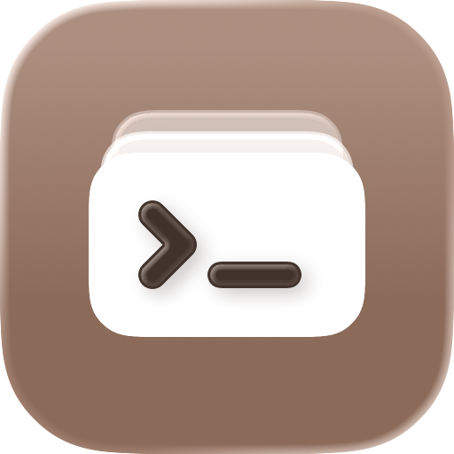

<div align="center">



# Berth

**One window for all your Claude Code sessions.**

A native macOS terminal that reads your sessions from `~/.claude`, groups them by project and shows which ones need you.

[Download](https://github.com/gustaferiksson/berth/releases/latest) · [Install with Homebrew](#install) · Requires macOS 26 and Apple silicon

</div>

## What it does

Berth puts every local Claude Code session in one sidebar, grouped under its project with the newest activity first. Badges show what is working, what needs you and what is running elsewhere. Pick a session and a terminal opens on the right. It resumes with `claude --resume`, attaches to a background session with `claude attach`, or opens a plain shell.

The terminal is libghostty and uses your own Ghostty config. Berth keeps no database. The sidebar is read from `~/.claude` on every change, and the app only stores UI state.

| | |
|---|---|
| **Sessions sidebar** | Group by project, repository or recent. Pin, snooze and archive sessions, and see live working and needs-you badges. |
| **Launcher and search** | ⌘N starts a session in a folder, ⌘K opens the command palette and ⇧⌘F searches every prompt and reply. |
| **Conversation view** | The session as a conversation over the hidden terminal, with inline tasks, images and code. Opt in. |
| **Review** | Changes, diffs, inline blame and pull requests next to the terminal. Language servers are a separate opt-in. |
| **Browser** | A Browser pane per session. Agents can drive it once you allow them. |
| **Codex** | Lists, resumes and shows Codex sessions in the Conversation view. Opt in. |
| **Agent control** | A `berth` command, skill and hook that let a session open tabs, run dev servers and read the Browser. Installed only when you click. |
| **Berth Remote** | An iOS app that watches and answers your sessions over Tailscale. Opt in. |
| **Updates** | Checks GitHub Releases and installs new versions in place. |

Everything beyond the sidebar and terminal is **off** by default. Turn features on in Settings (⌘,). Stored keys are listed in [docs/SETTINGS.md](docs/SETTINGS.md).

## Install

```sh
brew install --cask gustaferiksson/tap/berth
```

Or download `Berth-<version>.zip` from the [latest release](https://github.com/gustaferiksson/berth/releases/latest) and move `Berth.app` to `/Applications`. Berth is signed and notarized, and updates itself. Berth ▸ Check for Updates… checks right away.

You also need the `claude` CLI.

## Shortcuts

| Shortcut | Action |
|---|---|
| ⌘N | New session in a folder (⌘O in the launcher browses for one) |
| ⌘K | Command palette |
| ⇧⌘F | Search every session's prompts and replies |
| ⌘T | New terminal in the sidebar's Terminals group |
| ⌘J | Switch between the last terminal and the last Claude session |
| ⌥⌘K | Clear the terminal |
| ⇧⌘S | Stats |
| ⌃⌘1 / ⌃⌘2 / ⌃⌘3 | Group by project, repository or recent |
| ⌘1 to ⌘8, ⌘9 | Select a tab, the last tab |
| ⇧⌘] / ⇧⌘[ or ⌃⇥ / ⌃⇧⇥ | Next or previous tab |
| ↑ / ↓, Return | Move through the sidebar, open the session |
| ← / → | Collapse or expand a sidebar group |
| ⌘, | Settings |

## Berth Remote

Berth Remote is an iOS app for watching sessions and sending prompts from your phone. Turn on Remote in Settings, then reach the Mac over Tailscale. Berth listens on 127.0.0.1 only, and the token never leaves your devices.

The app is an Ad Hoc build for registered devices. Open <https://gustaferiksson.github.io/berth/> in Safari on the device and tap Install.

<details>
<summary><b>Building from source</b></summary>

<br>

You need Xcode and [XcodeGen](https://github.com/yonaskolb/XcodeGen) (`brew install xcodegen`).

```sh
./build.sh                                      # dist/Berth.app, ad hoc signed unless .env sets a team
swift test --package-path Packages/BerthCore
open dist/Berth.app
```

`CONFIGURATION=Debug ./build.sh` builds a Debug app into `.build/`. Copy `.env.example` to `.env` to build signed. The Xcode project is generated by XcodeGen and is not tracked. Releases are tagged and built by GitHub Actions, see [docs/RELEASING.md](docs/RELEASING.md) and [SHIPPING.md](SHIPPING.md). Design notes live in [design/](design/modules.md).

</details>

## License

[PolyForm Noncommercial 1.0.0](LICENSE).
